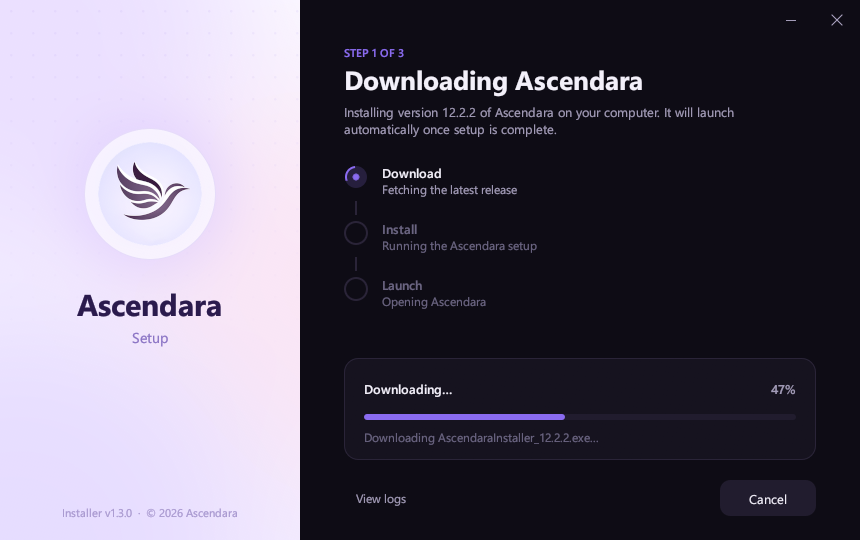

<div align="center">
    
    <h1>Ascendara Installer</h1>
    <p>
        
        <a href="https://ascendara.app/"></a>
        
    </p>
</div>

## 📦 About

The Ascendara Installer provides a modern, user-friendly interface for installing Ascendara on your computer. 
It serves as a wrapper around the core Electron-based installation process, offering a seamless and visually 
appealing experience.

## ✨ Key Features

- Modern and intuitive user interface
- Real-time installation progress tracking
- Automatic download of the latest Ascendara version
- Built-in logging and error handling

## 📸 Preview
<div align="center">
    
</div>


## 🚀 Installation Process

The installer handles the following tasks:
1. Downloads the latest Electron installer package
2. Provides visual feedback during the installation process
3. Manages the core installation through the Electron installer
4. Ensures proper cleanup after installation

## 🔧 Project Structure

The installer is a single native Rust executable (no runtime required):

- **`src/main.rs`**: Entry point and window setup
- **`src/app.rs`**: Main installer window (layout, steps, progress, animations)
- **`src/installer.rs`**: Downloads the latest Ascendara setup and runs it
- **`src/log_window.rs`**: Live log viewer
- **`src/theme.rs`**: Palette, fonts and the rendered hero panel
- **`src/logging.rs`**: Logging to memory, stdout and `%LOCALAPPDATA%\Ascendara\InstallerLogs`
- **`src/win.rs`**: Windows helpers (dark mode detection, rounded corners, fade)

## 💻 Building From Source

### Prerequisites
- [Rust](https://rustup.rs/) (stable, MSVC toolchain on Windows)
- Git (for cloning the repository)

### Setup and Run
1. Clone the repository
   ```
   git clone https://github.com/ascendara/installer.git
   cd installer
   ```

2. Run the application
   ```
   cargo run
   ```

   Debug builds honour `ASCENDARA_SKIP_SETUP=1`, which downloads the setup but doesn't run it.

### Building Executable
To build a standalone executable installer, run the build script
```
build-executable.bat
```

This will create `dist\AscendaraInstaller.exe`, which can be distributed to users.

## 📝 License & Contact  

This project is part of the Ascendara ecosystem

Licensed under [MIT](./LICENSE) - 2026 tagoWorks

### Get in Touch
- Email: [santiago@tago.works](mailto:santiago@tago.works)
- Website: [tago.works](https://tago.works)
- Discord: [Join our community](https://ascendara.app/discord)

---
<div align="center">
    <sub>Built with 💖 by <a href="https://tago.works">tago</a></sub>
</div>
